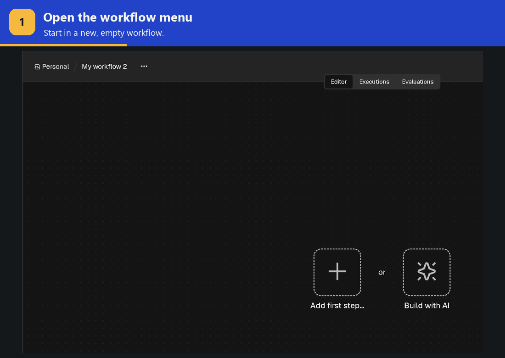
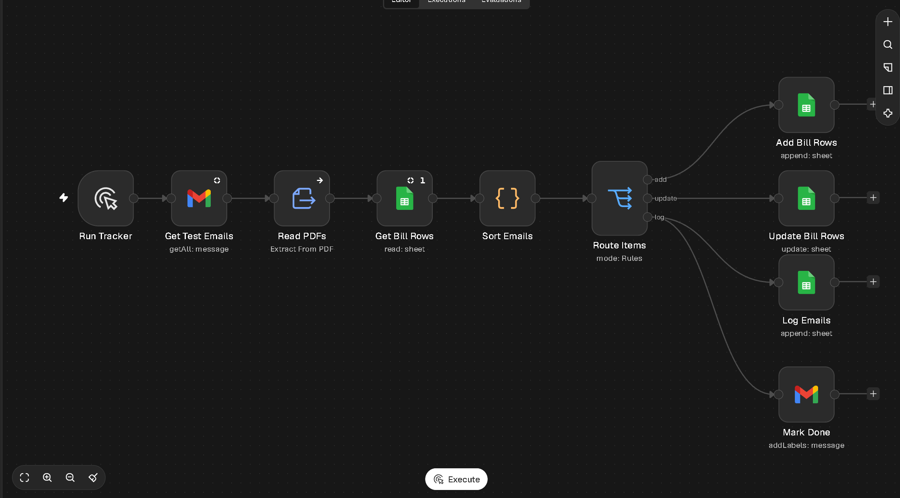
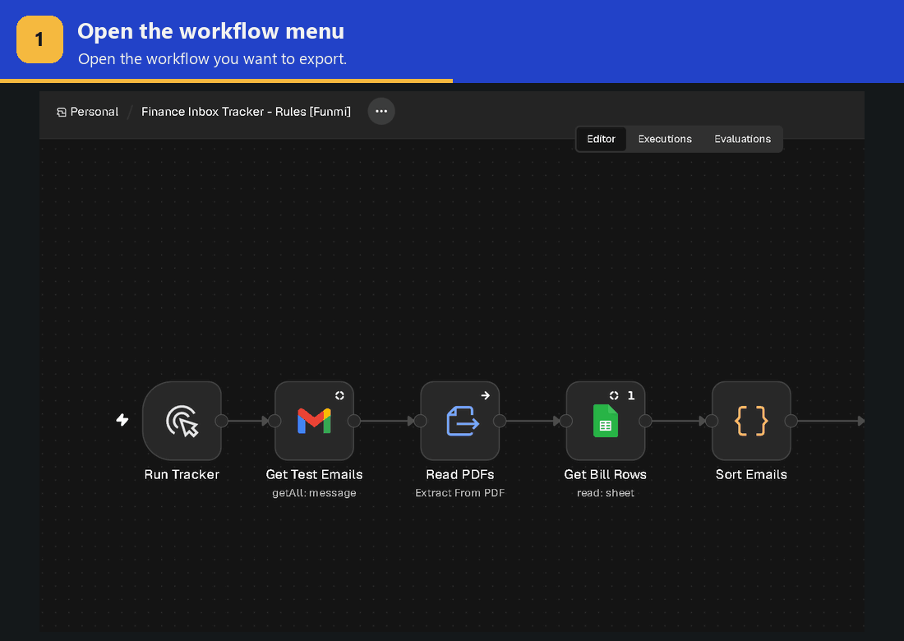

# Project 1: Finance Inbox Tracker — AI version

This continues [Project 1: Finance Inbox Tracker](project-1.md) by replacing rules-based nodes with AI. Follow the steps below.

## Set up Class 2 workflow
In order to make sure we're all starting at the same point, you will import and build upon an existing rules-based workflow. 

### 1. Import the workflow

<p><a href="finance-inbox-tracker-rules.json" download="Finance Inbox Tracker - Rules.json" style="display:inline-block; padding:0.7em 1em; border:1px solid var(--links); border-radius:6px; background:var(--links); color:var(--bg); font-weight:600; text-decoration:none;">Download the rules workflow (.json)</a></p>

1. Click the download button above. Keep **Finance Inbox Tracker - Rules.json** in your Downloads folder; you’ll attach this same file to Claude in Round 1.

2. Open the [SchoolRunbook n8n workspace](https://schoolrunbook.app.n8n.cloud/home/workflows) and create a **new workflow**.

3. Click the **three dots (⋯)** beside the workflow’s name and choose **Import → From file**.

4. Select **Finance Inbox Tracker - Rules.json** from Downloads and click **Open**.

5. Rename the workflow **[your name] - Class 2 - Finance Inbox Tracker**.



Your imported workflow should look like the example below. It reads the sheet before sorting, then adds bills, updates existing bills, logs emails and marks them done.



### 2. Copy the spreadsheet

<p><a href="https://docs.google.com/spreadsheets/d/1_Ok9nxpc42o7VFwS6Fh2qBfzBlgAUu7-eW_-vt9hFF8/copy" style="display:inline-block; padding:0.7em 1em; border:1px solid var(--links); border-radius:6px; background:var(--links); color:var(--bg); font-weight:600; text-decoration:none;">Make a copy of the Class 2 spreadsheet</a></p>

1. Open the link above and click **Make a copy**. Sign in to Google if asked.

2. Rename your copy **[your name] - Class 2 - Finance Inbox Tracker**.

3. Keep the sheet open in its own tab. You’ll connect it to n8n and paste its link into Claude.

The tabs and columns are already set up. Keep the tab names as they are.

### 3. Connect your accounts

1. In your n8n workflow, open **Get Test Emails** and **Mark Done** and select your Gmail credential. In **Mark Done**, select **srb-done**.

2. Open **Get Bill Rows**, **Add Bill Rows**, **Update Bill Rows** and **Log Emails**. In each node, select your Google Sheets credential and your new **Class 2 spreadsheet**.

3. Leave the selected tabs as they are: **Automation - Rules** in the three bill nodes and **Inbox Log** in **Log Emails**.

<a id="reset-test-emails"></a>

### 4. Reset Gmail

The workflow skips emails labelled **srb-done**. Remove that label from the practice emails so this workflow can read them again.

1. In Gmail, search for `label:srb-test label:srb-done`.

2. Select all matching emails. If Gmail offers **Select all conversations that match this search**, click it too.

3. Click the label icon, untick **srb-done**, then click **Apply**. Keep **srb-test** selected.

If the search finds no matches, continue to the next step.

### 5. Run it once

1. Click **Execute workflow** at the bottom of the n8n canvas and wait for the run to finish.

2. Open your Class 2 spreadsheet and check that **Automation - Rules** and **Inbox Log** contain results.

3. Keep those rows. You’ll compare them with the AI results later.

If the run shows an error or no emails are processed, ask a TA for help before moving to Round 1.

<a id="round-1"></a>
<a id="1-let-claude-read-the-attachments"></a>

## Round 1: Let Claude read the attachments

**Why:** the **Read PDFs** node only reads PDF text. A scanned invoice, receipt photo, spreadsheet or email with several attachments needs a more flexible reader. This first change uses AI to read the files and pass their information along with the email.

1. Open the **same Finance Inbox Tracker chat** inside your **SchoolRunbook projects** project in Claude.

2. Attach **Finance Inbox Tracker - Rules.json**, the file you downloaded at the start.

3. Copy the prompt below. Replace **[paste the link to your new sheet here]** with the link to your copy of the spreadsheet. Copy it from your browser's address bar while your sheet is open.

4. Send the prompt with the JSON attached. Follow Claude’s guidance in your **Class 2 workflow**, one step at a time, to build and test attachment reading.

**Done when:** a test run fills your AI tabs, and the rows include details from scanned files and from every attachment on emails with more than one.

```text
My Google Sheet: [paste the link to your new sheet here]

I've attached the rules workflow JSON I downloaded and imported into n8n. I'm adding AI to this Class 2 workflow. Use this JSON as our starting point.

Let's simply use AI to read all the attachments on each email, including PDFs, images and spreadsheets, so we don't miss information when the files look different. This is the only change I want to make right now.

Keep my rules results unchanged and use the AI tabs in the same spreadsheet. Guide me through the change and testing, one step at a time.
```

<a id="round-2"></a>
<a id="2-let-claude-sort-the-emails"></a>

## Round 2: Let Claude sort the emails

**Why:** the code in **Sort Emails** follows fixed rules. New wording, a different invoice layout or information spread across several files can mean rewriting those rules. AI can use the meaning of the email and attachments to decide what happens next, while following the same business rules.

> [!IMPORTANT]
> **Keep the sheet-reading node.** **Get Bill Rows** gives the AI the existing bills before it sorts the emails. That is how it can attach a reminder to a bill already on the sheet. Marcus's approvals, payment decisions and notes still belong to him.

Continue once attachment reading is working. In the **same Claude chat**, send this prompt and follow Claude’s guidance in the **same Class 2 workflow**.

```text
Now let's use AI to understand and sort emails and invoices, even when their wording or layout is unfamiliar, and decide what to add or update using the email, all its attachments and the bills already on the sheet. I want to still keep the same business rules.
```

**Done when:** a test run sorts every email into your AI tabs with no errors, and a reminder email updates its existing bill instead of adding a new row.

## Compare your results

Once both rounds are working, compare them with your rules version using the same practice emails.

1. If your AI tabs contain results from earlier tests, ask Claude to guide you through clearing only those generated test rows in **Automation - AI** and **Inbox Log - AI**. Keep the headers and your rules results.
2. [Reset the practice emails' completion label](#reset-test-emails).
3. Run your completed **AI workflow** and wait for it to finish.
4. Compare the rules and AI results with the original emails and attachments. Which gets things right more often? Note a specific example for your submission.

These steps are for a fresh comparison. If you're testing how a reminder updates an existing bill, keep that bill's row and follow Claude's guidance.

## Your AI workflow

Your AI workflow should follow this order:

**Get emails → AI reads attachments → Read existing bills → AI sorts emails → Route items → Update the sheet and mark emails done.**

Claude may add a few supporting nodes. What matters is that both AI changes work and the rest of Marcus's process stays the same.

## Stretch tasks

Finish both rounds first, then pick a task. Copy its prompt into the **same Finance Inbox Tracker chat in Claude** and follow its guidance in your **AI workflow**.

### Explain what each bill is for

**Why:** a vendor’s name and an amount may not explain what the school bought. A short description on each bill’s row lets Marcus understand the charge without reopening the email and attachments.

```text
Let’s add a short, plain-language description of what each bill is for on its row, so Marcus can understand the charge from the sheet.
```

### Group bills by what the school is buying

**Why:** bills for similar expenses can come from different vendors. Giving each bill an expense category, such as transport, software or repairs, helps Marcus find related costs together on the sheet.

```text
Let’s add an expense category to each bill, such as transport, software or repairs, so Marcus can group similar costs on the sheet. Help me decide what the categories should be.
```

### See what has been paid and what is still owed

**Why:** Marcus can see every bill, but he still has to add up what’s been paid, what’s unpaid and what’s late. A Summary tab puts those totals in one place and shows the period covered by the emails the tracker has processed.

```text
Let’s add a Summary tab that updates after each run. For the bills from all emails processed so far, show the date range covered by those emails, the total paid, the total still outstanding and how much of that outstanding amount is past due. Base the totals on Marcus’s recorded bill statuses, excluding denied bills, and count each bill once.
```

<a id="export-workflow-json"></a>

## Export your completed workflow

1. Open your **[your name] - Class 2 - Finance Inbox Tracker** workflow in n8n after completing both rounds.

2. Click the **three dots (⋯)** beside its name and choose **Export JSON**.

3. Keep the downloaded JSON file. You’ll upload it using the submission form below.



## Submit your project

> [!IMPORTANT]
> **Submit your completed Project 1 before class on November 10.**
>
> Finish both rounds and compare the results with your rules version. Export your **completed AI workflow** as a JSON file, including any stretch tasks you completed, then **[submit your final project using this form](https://docs.google.com/forms/d/e/1FAIpQLSfTDUwvMkP6TDJliJZKj3Ac6L8GBYBL2sdvzcVkNe4cgXJy2Q/viewform)**. Include a specific example from your comparison in the form.
>
> [Find instructions here on how to export your JSON file](#export-workflow-json). Follow the steps on your **completed Class 2 workflow**.
>
> Stretch tasks are optional.

<!-- Keep every link on this guide in a new tab, without changing other course pages. -->
<script>
(function () {
  if (!window.location.pathname.endsWith('/project-1-ai-automation.html')) return;

  function setNewTab(link) {
    link.target = '_blank';
    link.relList.add('noopener', 'noreferrer');
  }

  function updateLinks(root) {
    if (root.matches?.('a[href]')) setNewTab(root);
    root.querySelectorAll?.('a[href]').forEach(setNewTab);
  }

  function initializeLinks() {
    updateLinks(document);
    // Include links added later, such as search results, without changing downloads.
    new MutationObserver(function (records) {
      records.forEach(function (record) {
        record.addedNodes.forEach(updateLinks);
      });
    }).observe(document.body, { childList: true, subtree: true });
  }

  if (document.readyState === 'loading') {
    document.addEventListener('DOMContentLoaded', initializeLinks, { once: true });
  } else {
    initializeLinks();
  }
})();
</script>
